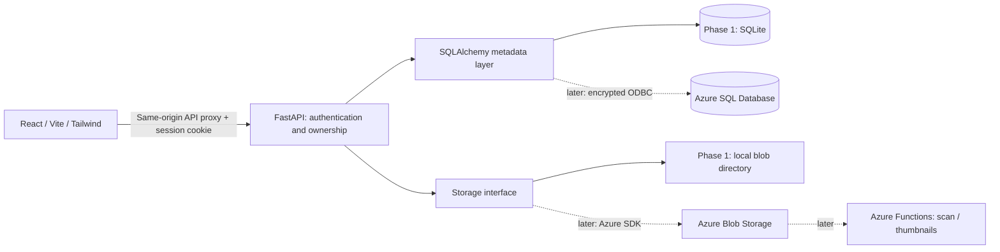

# Architecture and Azure roadmap

The browser never accesses SQL or storage credentials. Every private file/folder lookup verifies owner ID. A shared-download route is the deliberate exception: it requires an unexpired cryptographically random bearer token, hashed in SQL. Links proxy attachment downloads through the backend, avoiding executable inline content. Each blob gets an opaque unique key independent of the supplied filename.

## Relational schema

| Table | Main fields | Relationships |
|---|---|---|
| users | UUID, name, normalized unique email, Argon2 hash, created time | owns sessions, folders, files |
| sessions | SHA-256 token digest, expiry | user_id → users |
| folders | UUID, name, owner, nullable parent, created time | owner_id → users; parent_id → folders |
| files | UUID, name, blob key, byte size, MIME label, created time | owner_id → users; folder_id → folders |
| shares | UUID, token digest, expiry, created time | file_id → files |

No binary file contents are in SQL. Sessions/share links store only token hashes. API logic enforces same-owner parent and destination folders. Times are naive UTC in SQL and explicitly serialized with Z. Schema IDs/timestamps are supplied by SQLAlchemy application defaults. The SQL Server schema is in `backend/schema/azure_sql.sql` and can be regenerated from the backend directory with `..\.venv\Scripts\python.exe -m scripts.export_schema`.

## Azure phase acceptance criteria

1. Provision private Blob Storage and Azure SQL; configure managed identity or secrets only on the backend. Configure TLS/ODBC Driver 18 and least privilege.
2. Add an Azure storage adapter implementing the existing `put`/`read`/`delete` contract. Downloads already stream byte chunks without exposing local paths. Verify identical lifecycle and authorization tests against Azure.
3. Introduce migrations for an existing schema; `create_all` currently bootstraps an empty development database and does not migrate changes.
4. Enable actual Blob versioning, save/version IDs as appropriate, and implement list/restore operations. Never fabricate local version history.
5. Prove content lives in Blob Storage while SQL contains only metadata; verify link expiry, revocation, failure recovery and ownership against live services.
6. Only then add Functions and App Service, request limits, rate limits, durable deletion, diagnostics and backups.
